# splitit on AWS EKS

A no-login expense splitter, deployed to Amazon EKS with Terraform, GitHub Actions and Argo CD.

Create a group, share the link, add expenses and see who owes whom. A Go API and a React frontend run on Kubernetes behind Traefik, with RDS PostgreSQL and a Redis cache. Git is the source of truth for the cluster: a merged app change was live in under 4 minutes, with no manual deploy step.

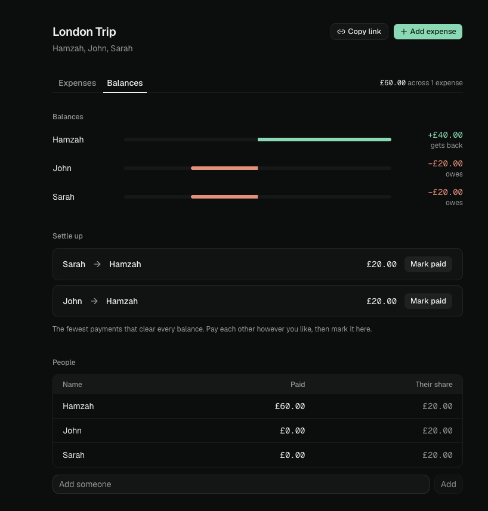

## Architecture

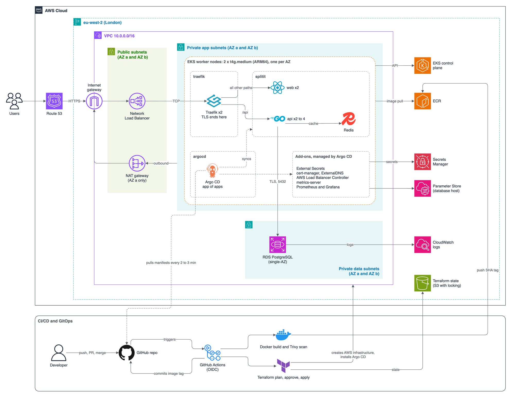

| Service | Built with | What it does |
|---------|------------|--------------|
| **web** | React, NGINX | Serves the static frontend to the browser |
| **api** | Go | Handles groups, members, expenses and balances |
| **redis** | Redis 7 | Caches balances for 5 minutes. Cleared when a group changes |
| **database** | RDS PostgreSQL 16 | Stores all the data |

**Request path:** Route 53 → Network Load Balancer (TCP) → Traefik pods (TLS ends here, HTTP redirects to HTTPS) → `/api` goes to the API and everything else to web. The browser calls the API on the same hostname, so web and API never talk to each other. Only the API uses Redis and Postgres.

**Network:** one VPC across two Availability Zones in eu-west-2, with three subnet tiers.

- **Public:** the load balancer and one NAT gateway.
- **App:** the EKS nodes and pods, with no public IPs.
- **Data:** RDS, which only accepts connections from the nodes.

**Who owns what:**

- **Terraform** creates the AWS infrastructure, installs Argo CD and creates the root application.
- **Argo CD** runs everything else in the cluster from Git.
- **GitHub Actions** builds images and updates their tags in Git. It never deploys the app directly.

**Healthy Traefik targets in both Availability Zones:**

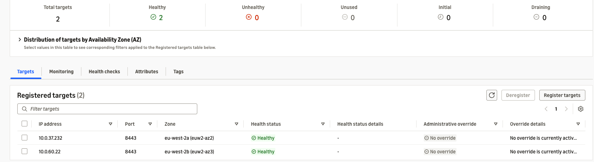

**HTTPS certificate issued by Let's Encrypt through cert-manager:**

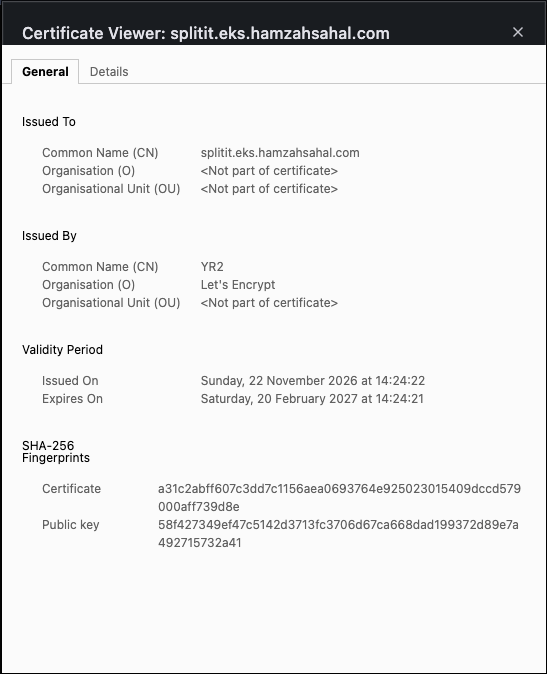

## Contents

- [Repo layout](#repo-layout)
- [Key components](#key-components)
- [App Helm chart](#app-helm-chart)
- [Deployment workflow](#deployment-workflow)
- [Decisions and trade-offs](#decisions-and-trade-offs)
- [Build practices](#build-practices)
- [Proof it works](#proof-it-works)
- [Troubleshooting](#troubleshooting)
- [Security practices](#security-practices)
- [Run it locally](#run-it-locally)
- [Deploy to AWS](#deploy-to-aws)
- [Teardown](#teardown)
- [Planned improvements](#planned-improvements)

## Repo layout

```
.
├── .github/workflows/
├── api/
│   ├── cmd/splitit/
│   ├── internal/
│   ├── migrations/
│   └── Dockerfile
├── web/
│   ├── src/
│   ├── nginx.conf
│   └── Dockerfile
├── splitit-helm/
│   ├── templates/
│   └── values.yaml
├── argocd/
│   ├── apps/
│   ├── cluster-config/
│   ├── root-app.yaml
│   └── values.yaml
├── terraform/
│   └── modules/
│       ├── network/
│       ├── eks/
│       ├── irsa/
│       ├── database/
│       └── argocd/
├── compose/
├── docs/images/
├── docker-compose.yml
└── .pre-commit-config.yaml
```

## Key components

| Component | What it does | Where |
|-----------|--------------|-------|
| **Cluster** | EKS 1.37 with two ARM64 `t4g.medium` nodes across two AZs | [`terraform/modules/eks`](terraform/modules/eks) |
| **Network** | Three subnet tiers and one NAT gateway | [`terraform/modules/network`](terraform/modules/network) |
| **Database** | Private, encrypted, single-AZ RDS PostgreSQL | [`terraform/modules/database`](terraform/modules/database) |
| **Cache** | Redis caches balances for 5 minutes, so repeat reads skip Postgres. A change to the group clears its entry, and the API falls back to Postgres if Redis is down | [`redis.yaml`](splitit-helm/templates/redis.yaml), [`cache`](api/internal/cache) |
| **Pod permissions** | Five IRSA roles, one for each component that calls AWS | [`terraform/modules/irsa`](terraform/modules/irsa) |
| **GitOps** | Argo CD keeps the cluster matching Git, removing what's deleted from Git and reverting manual changes | [`argocd`](argocd) |
| **App of apps** | One root Argo CD Application watches a folder of 11 child Applications, one each for splitit, the add-ons and shared config. Terraform only creates the root, which creates the rest. Adding a component means committing one Application file | [`root-app.yaml`](argocd/root-app.yaml), [`argocd/apps`](argocd/apps) |
| **App chart** | Everything splitit runs in the cluster. See [App Helm chart](#app-helm-chart) | [`splitit-helm`](splitit-helm) |
| **Ingress, DNS and TLS** | Traefik with the Gateway API, AWS Load Balancer Controller, ExternalDNS and cert-manager | [`argocd/apps`](argocd/apps) |
| **Secrets** | External Secrets copies values from Secrets Manager and Parameter Store | [`externalsecret.yaml`](splitit-helm/templates/externalsecret.yaml) |
| **Monitoring** | Prometheus scrapes the cluster, API and Traefik. Grafana has cluster and Traefik dashboards | [`kube-prometheus-stack.yaml`](argocd/apps/kube-prometheus-stack.yaml) |
| **Scheduled job** | Kubernetes CronJob for inactive groups | [`cleanup.yaml`](splitit-helm/templates/cleanup.yaml) |
| **CI/CD** | Image, GitOps and Terraform workflows, using OIDC to reach AWS | [`.github/workflows`](.github/workflows) |

## App Helm chart

[`splitit-helm`](splitit-helm) deploys web, API and Redis, along with their routes, secret, monitoring and Jobs.

**Availability**

| Feature | Setting | Why |
|---------|---------|-----|
| **Replicas** | Two web, two to four API, one Redis | Web and API can lose a pod and keep serving |
| **Rolling updates** | Web and API: `maxUnavailable: 0`, `maxSurge: 1` | A new pod is ready before an old one stops |
| **Pod disruption budgets** | Web and API: `maxUnavailable: 1` | A node drain can't evict both replicas at once |
| **Unhealthy pod eviction** | `AlwaysAllow` | A broken pod can't block a node drain |
| **Topology spread** | Web and API across nodes, `maxSkew: 1`, soft | Replicas are spread out, but can still schedule if only one node is left |
| **Anti-affinity** | Preferred, on web | Favours putting web replicas on different nodes |
| **Readiness probes** | API checks Postgres, web checks NGINX, Redis uses a ping | Pods only get traffic when they can serve it |
| **Liveness probes** | Web and API use `/healthz`, Redis uses a ping | A hung container is restarted automatically |
| **Shutdown delay** | 5 second `preStop` on web | Traffic stops arriving before NGINX exits |
| **Autoscaling** | API at 70% of requested CPU | Adds pods under load |

**Resources**

| Workload | CPU request | Memory request | Memory limit |
|----------|-------------|----------------|--------------|
| API, Redis, Jobs | 50m | 64Mi | 128Mi |
| Web | 20m | 32Mi | 64Mi |

- **No CPU limits:** pods can use spare CPU without being throttled.
- **ResourceQuota:** caps the namespace at 1 CPU and 1536Mi of requests, 3Gi of memory limits and 50 pods.
- **LimitRange:** gives default requests and a memory limit to any container without them, and caps each container at 1Gi.

**Config and Jobs**

- **ExternalSecret:** creates the database Secret, with the password from Secrets Manager and the host from Parameter Store.
- **Gateway and HTTPRoutes:** HTTPS, the HTTP redirect and path routing to web and API.
- **Migration Job:** creates and updates the database tables and indexes. It's a Helm hook, so Argo CD runs it after each sync.
- **ServiceMonitor:** tells Prometheus to scrape the API every 30 seconds.

## Deployment workflow

**1. Pull request**

Checks run for whatever changed:

- **App code:** both images are built and scanned with Trivy. Fixable criticals fail the check. Nothing is pushed.
- **Helm and Argo CD:** Gitleaks scans for secrets, and kube-linter and Checkov scan the chart. Checkov only reports.
- **Terraform:** format, TFLint, Checkov, validate and plan.

**2. Merge to main**

The image workflow builds and scans again, pushes to ECR with the commit SHA as the tag, then commits that tag to the Helm values.

**3. Argo CD sync**

Argo CD checks Git every 2 to 3 minutes. It sees the tag commit and rolls out the new pods. A new pod must be ready before an old one stops, and migrations run after the sync.

**Argo CD synced to the pipeline's tag commit:**

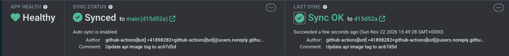

**Before and after a merge.** The only change was the headline. It merged at 15:45:38 and was live at 15:49:28.

| Before | After |
|--------|-------|
| 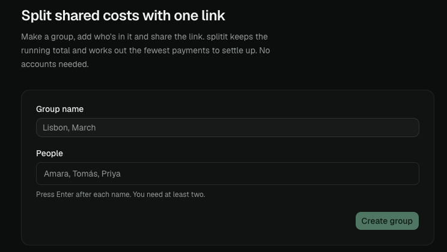 | 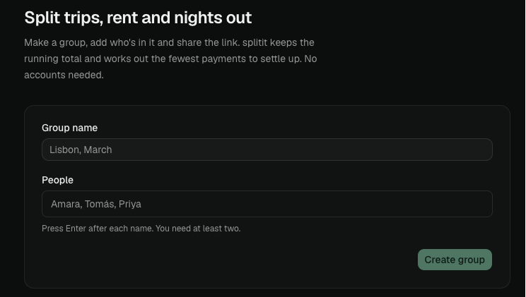 |

**Infrastructure changes**

Terraform plans on `main`, then apply waits for approval on the protected `prod` environment.

**Bootstrap order**

On a new cluster, sync waves create the applications in dependency order. Argo CD doesn't assess the health of child Applications by default, so [`argocd/values.yaml`](argocd/values.yaml) restores that check for the waves to wait on, as described in the [Argo CD resource health docs](https://argo-cd.readthedocs.io/en/stable/operator-manual/health/#argocd-app).

| Wave | Applications |
|------|--------------|
| 0 | Gateway API and Prometheus Operator CRDs |
| 1 | cert-manager, External Secrets, ExternalDNS, metrics-server |
| 2 | AWS Load Balancer Controller |
| 3 | Traefik, cluster config |
| 4 | splitit, Prometheus and Grafana |

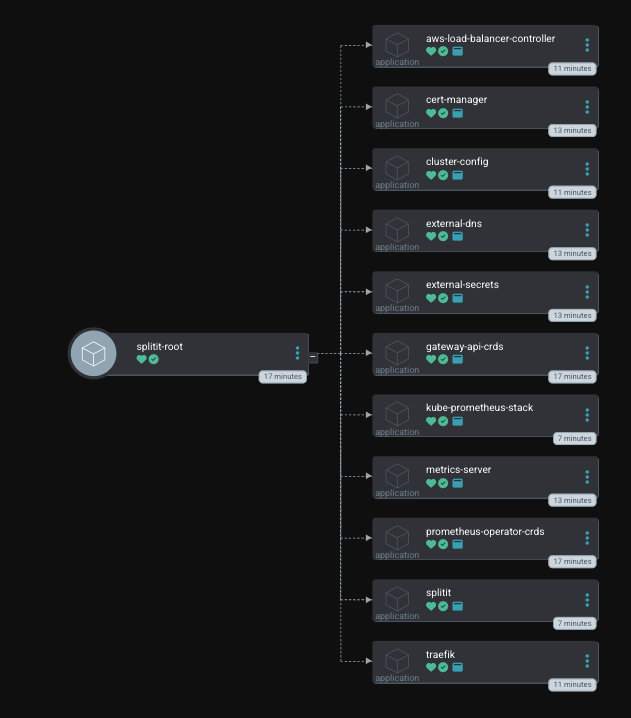

## Decisions and trade-offs

| Decision | Why | Trade-off |
|----------|-----|-----------|
| **App of apps, bootstrapped by Terraform** | One apply gives a working cluster, then Git manages what runs in it | Terraform installs Argo CD with Helm, so the CI runner needs network access to the EKS API and admin rights in the cluster |
| **Gateway API with Traefik, not Ingress** | The standard successor to Ingress. Each app owns its routes and listeners | Extra CRDs to install and keep up to date, where Ingress is built into Kubernetes |
| **RDS, not Postgres in the cluster** | The data isn't tied to a node or volume, and AWS handles backups and patching | Costs more than running Postgres on the existing nodes |
| **IRSA** | Each component gets its own temporary AWS credentials | Each cluster needs an OIDC provider. EKS Pod Identity is a simpler alternative |
| **External Secrets with AWS Secrets Manager** | The password is in neither Git nor Terraform state | Another controller, and rotation isn't automatic |
| **cert-manager, not ACM** | TLS ends at Traefik, and each Gateway gets a certificate that renews itself | Certificates and keys live in the cluster |
| **One NAT gateway** | About half the cost of one per AZ | If its AZ fails, both AZs lose outbound internet |
| **Public EKS endpoint** | GitHub-hosted runners can reach it. IAM and access entries control who gets in | Reachable from the internet. A private endpoint with AWS CodeBuild-hosted GitHub Actions runners inside a VPC would close it |

## Build practices

- **Pre-commit hooks:** gitleaks, `terraform fmt`, `validate` and TFLint, hadolint, `helm lint`, gofmt and basic file checks.
- **Git:** feature branches for each section, merged through pull requests.
- **Images:** multi-stage, non-root, built natively for ARM64 and tagged with the commit SHA.
- **Versions:** Helm charts, GitHub Actions and base images use version tags, never `latest`.
- **Terraform:** one module per area, encrypted remote state with locking, and default tags.
- **CI:** no stored AWS keys, and approval before every apply or destroy.

## Proof it works

**Zero downtime during a node drain:** all 368 requests returned 200. The app and Traefik pods moved to the remaining node.

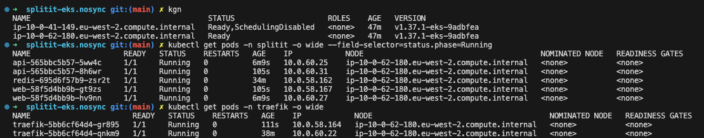

**Disruption budget:** draining the second node was refused, because it would have taken down the last ready web pod.

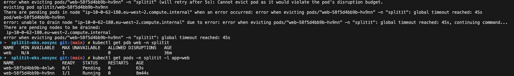

**Self-heal:** a manual scale from 2 to 5 replicas was reverted by Argo CD within about a second.

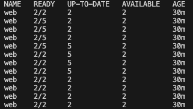

**Autoscaling:** under load, the API went from 2 to 4 pods in about 30 seconds.

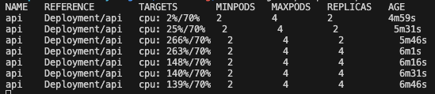

**Monitoring:** Grafana showing the splitit pods. CPU limits show no data because none are set, to avoid throttling.

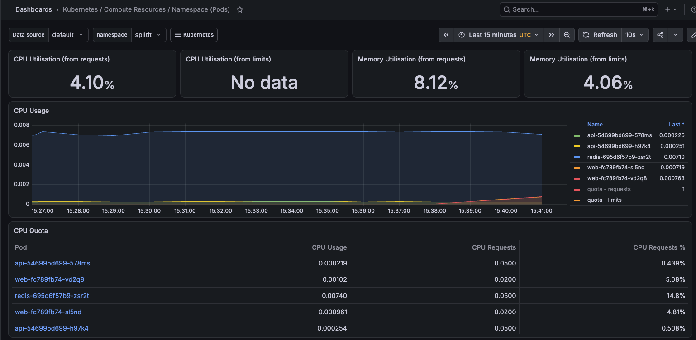

## Troubleshooting

### splitit deadlocked on first boot

splitit synced before the External Secrets webhook was ready, so its secret was never created. The API waited for the secret, and the sync waited for the API, so it never finished or retried.

**Fix:** sync waves, plus an [Application health check](argocd/values.yaml) so the root app waits on each wave's health. The check comes from the [Argo CD docs](https://argo-cd.readthedocs.io/en/stable/operator-manual/health/#argocd-app).

### The load balancer blocked destroy

The load balancer is created by a controller, so Terraform doesn't know about it. Left behind, it blocks deletion of the VPC.

**Fix:** the destroy workflow deletes the Argo CD applications and Traefik's Service first, and stops if the load balancer still exists.

## Security practices

**Access**

- GitHub Actions assumes an AWS role through OIDC, and the role only trusts this repository.
- IRSA roles are tied to one service account each. ExternalDNS and cert-manager can only change records in this hosted zone.
- Cluster access is granted through explicit EKS access entries.

**Secrets**

- Terraform generates the database password as an ephemeral value and writes it to AWS Secrets Manager.
- Pods read the password from a mounted file, not an environment variable.

**Network and encryption**

- The load balancer is the only public way into the app. Nodes and RDS are private.
- RDS storage and Terraform state are encrypted. Traffic uses HTTPS to Traefik and TLS to RDS.

**Containers**

- All splitit containers run as non-root with read-only root filesystems.
- The namespace has a resource quota and default limits.
- Images with fixable critical vulnerabilities aren't pushed to ECR.

**What the scans changed**

- kube-linter's 9 findings went to 0 with no exclusions: read-only filesystems, safer eviction policies for unhealthy pods, anti-affinity for web and automatic removal of finished migration Jobs.
- Those fixes took Checkov from 70 findings to 60. The rest are false positives, deliberate choices such as no CPU limits, or listed in [Planned improvements](#planned-improvements).
- Trivy failed the web image, which led to a newer NGINX base image.

## Run it locally

```bash
git clone https://github.com/HamzahS-101/splitit-eks.git
cd splitit-eks
docker compose up --build
```

Open http://localhost:8080. `docker compose down` stops it. Add `-v` to also delete the database.

## Deploy to AWS

**One-time setup:**

1. An encrypted S3 bucket for Terraform state.
2. ECR repositories `splitit-api` and `splitit-web`, with immutable tags.
3. A Route 53 hosted zone for your domain.
4. A GitHub OIDC provider and an IAM role that trusts your repository.
5. A Secrets Manager secret `splitit/grafana/admin` with the keys `admin-user` and `admin-password`.
6. A GitHub environment called `prod` with a required reviewer.

Replace the account ID, role ARNs, bucket, domain, zone ID and repo URL in `.github/workflows/`, `terraform/`, `argocd/` and `splitit-helm/values.yaml`.

**Deploy:**

1. Run **Docker build, scan and push to ECR**.
2. Run **Terraform plan**, review it, then approve **Terraform apply**. It creates 76 resources in about 18 minutes, and Argo CD installs the rest.

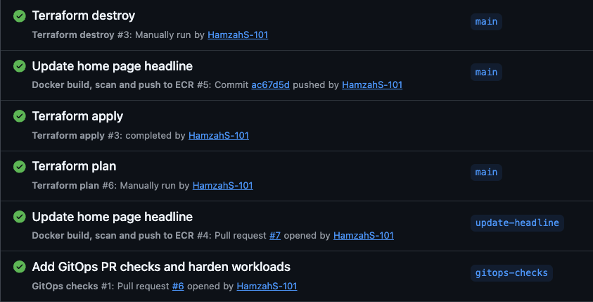

## Teardown

Run **Terraform destroy** and approve it. It takes about 13 minutes.

The one-time setup stays, ready for the next deploy.

## Planned improvements

**Reliability**

- Multi-AZ RDS, a NAT gateway per AZ and a Redis replica.
- Node autoscaling.
- Finish and end-to-end test the cleanup job.

**Deployments**

- Branch protection with required checks, and schema validation with kubeconform.
- An Argo CD webhook instead of polling.
- Canary releases with Argo Rollouts.
- Cluster config one wave after Traefik.

**Security**

- A private EKS endpoint with AWS CodeBuild runners in a VPC, and a narrower GitHub Actions role.
- NetworkPolicies, rate limiting and data subnets with no internet route.
- Dropped capabilities, seccomp, high UIDs and no mounted service account tokens.
- An admission policy, secret rotation and SSO for Argo CD and Grafana.

**Observability**

- Alertmanager, log shipping and persistent Prometheus storage.
